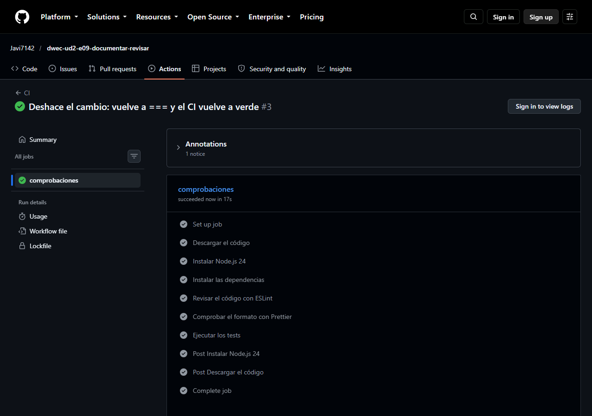
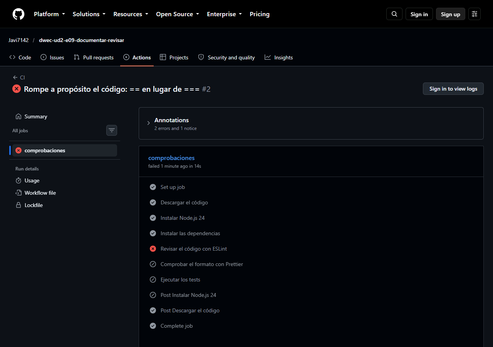

# Documentar y revisar

Módulo `biblioteca.js` de la biblioteca del instituto, con las funciones renombradas, documentadas con JSDoc, sin errores de ESLint, formateado con Prettier y con sus primeros tests (Vitest).

| Nombre original | Nombre nuevo | Qué hace |
|-----------------|--------------|----------|
| `MULTA`, `MAX` | `MULTA_POR_DIA`, `MULTA_MAXIMA` | Multa diaria (0,20 €) y tope de la multa (10 €) |
| (`limite` dentro de `puede`) | `LIMITE_PRESTAMOS` | Libros que un alumno puede tener prestados a la vez (3) |
| `f(d)` | `calcularMulta(diasRetraso)` | Multa por días de retraso |
| `titulo(t, a)` | `formatearTitulo(titulo, autor)` | Título entre comillas y autor entre paréntesis |
| `puede(n, multas)` | `puedePedirPrestado(prestamosActivos, tieneMultas)` | Si un alumno puede pedir otro libro |
| `cuenta(lista)` | `contarDisponibles(estados)` | Ejemplares con estado `'disponible'` |

## Cómo ejecutarlo

```bash
npm install          # instalar las dependencias (en el contenedor ya se hace solo)
npm start            # ejecutar el programa (main.js)
npm test             # ejecutar los tests con Vitest
npm run lint         # revisar el código con ESLint
npm run format       # dar formato con Prettier (reescribe los ficheros)
npm run format:check # comprobar el formato sin cambiar nada
```

## ESLint antes de los cambios

Salida de `npm run lint` con el código de partida (5 errores de tres reglas):

```text
> e09-documentar-revisar@1.0.0 lint
> eslint .
C:\Users\jacp9\Documents\2DAW\Desarrollo en entorno cliente\UD2_2DAW_DWEC_2627\practicas\ejercicios\E09-DocumentarRevisar\biblioteca.js
   5:1   error  Unexpected var, use let or const instead           no-var
  23:9   error  'limite' is never reassigned. Use 'const' instead  prefer-const
  24:5   error  Unexpected var, use let or const instead           no-var
  24:42  error  Expected '===' and instead saw '=='                eqeqeq
  33:18  error  Expected '===' and instead saw '=='                eqeqeq
✖ 5 problems (5 errors, 0 warnings)
  3 errors and 0 warnings potentially fixable with the `--fix` option.
```

## Reglas que fallaban

| Regla | Qué exige | Cómo se ha corregido |
|-------|-----------|----------------------|
| `no-var` | No usar `var`: se declara con `let` o `const`, que tienen ámbito de bloque. `var` tiene ámbito de función, se eleva (*hoisting*) y permite errores como usar la variable antes de declararla. Fallaba en la línea 5 (`var MULTA`) y en la 24 (`var resultado`) | `MULTA` pasa a `const MULTA_POR_DIA`, que nunca cambia, y `resultado` desaparece: la función devuelve directamente la expresión `prestamosActivos < LIMITE_PRESTAMOS && !tieneMultas` |
| `prefer-const` | Usar `const` si la variable nunca se reasigna. Fallaba en la línea 23 con `let limite = 3` | Es una constante con significado propio, así que sube al ámbito del módulo como `const LIMITE_PRESTAMOS = 3` y se documenta con `@type` |
| `eqeqeq` | Comparar con `===` y `!==`, que no convierten tipos, y no con `==` y `!=`. Fallaba en la línea 24 (`multas == false`) y en la 33 (`lista[i] == 'disponible'`) | `multas == false` se sustituye por `!tieneMultas` (el parámetro es un booleano) y `lista[i] == 'disponible'` por `estado === 'disponible'` |

Además se borraron los comentarios que repetían el código (`// constante`, `// función`, `// multiplicamos`…), se añadió JSDoc a todas las funciones y constantes y un comentario que explica el porqué del redondeo de la multa (`0.2 * 3` da `0.6000000000000001`). El bucle de `contarDisponibles` pasa de `for` con índice a `for…of`, más sencillo porque el índice no se usa para nada más.

## ESLint después de los cambios

Salida de `npm run lint` y de `npm run format:check` al terminar:

```text
> npm run lint
> eslint .

> npm run format:check
> prettier --check .
Checking formatting...
All matched files use Prettier code style!
```

`npm start` muestra lo mismo antes y después de los cambios:

```text
0.6
10
"Rayuela" (Julio Cortázar)
true
false
2
```

Con `// @ts-check` en la primera línea de `biblioteca.js`, el comprobador de tipos de TypeScript no marca ningún error en `biblioteca.js` ni en `main.js`; y una llamada como `calcularMulta('3')` sí se marca: `Argument of type 'string' is not assignable to parameter of type 'number'`.

## Tests

Salida de `npm test` (13 tests en cuatro `describe`):

```text
 Test Files  1 passed (1)
      Tests  13 passed (13)
   Start at  14:21:49
   Duration  343ms (import 60%, transform 28%, tests 6%, worker 6%)
```

| `describe` | Caso límite que prueba |
|------------|------------------------|
| `calcularMulta` | Sin retraso (0 días y días negativos, que dan 0 €) y justo la multa máxima (50 días × 0,20 € = 10 €), además de una multa por encima del tope (80 días, que se queda en 10 €) |
| `formatearTitulo` | Un título vacío (el resultado es `'"" (Anónimo)'`) |
| `puedePedirPrestado` | Justo el límite de préstamos (3 préstamos no permiten pedir otro) y multas pendientes sin préstamos |
| `contarDisponibles` | Una lista vacía y una lista en la que ninguno está disponible (resultado 0 en ambos casos) |

Comprobación de que los tests detectan cambios: al cambiar `MULTA_MAXIMA` de 10 a 12 falla `calcularMulta › no supera la multa máxima con muchos días de retraso` (`expected 12 to be 10`). El cambio se deshizo y los 13 tests vuelven a pasar.

## Integración continua (opcional)

- Repositorio: <https://github.com/Javi7142/dwec-ud2-e09-documentar-revisar>
- Ejecución en verde (6 pasos, tras deshacer el cambio): <https://github.com/Javi7142/dwec-ud2-e09-documentar-revisar/actions/runs/39422023255>



Captura de la ejecución en verde: los seis pasos del trabajo (descargar el código, instalar Node.js 24, instalar las dependencias, ESLint, Prettier y tests) terminan bien.

**Ejecución en rojo provocada a propósito.** Para provocarla se escribió `==` en lugar de `===` en `contarDisponibles` (`estado == 'disponible'`), se subió el cambio y la ejecución ([#2](https://github.com/Javi7142/dwec-ud2-e09-documentar-revisar/actions/runs/39421930996)) falló en el paso **Revisar el código con ESLint** con `76:16 error Expected '===' and instead saw '==' eqeqeq`; los pasos de Prettier y de los tests se saltaron. Después se deshizo el cambio y la ejecución volvió a verde.



En la captura se ve el paso **Revisar el código con ESLint** en rojo y los siguientes (Prettier y tests) saltados.
